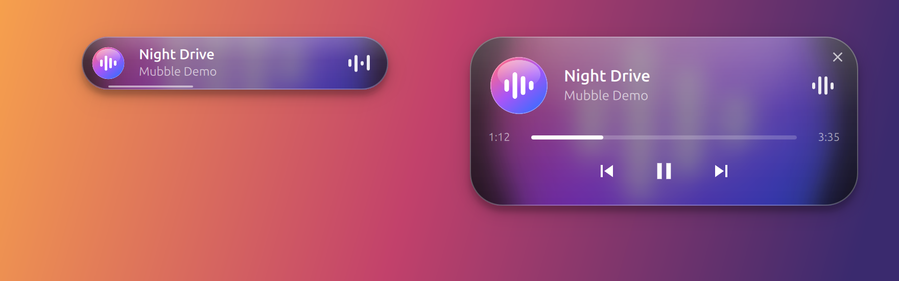
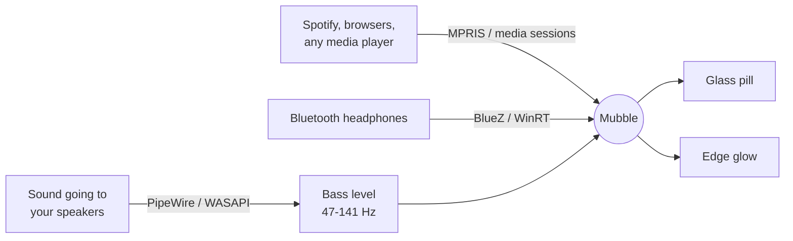

<div align="center">


# Mubble

**Your music, in a floating glass pill.**

Mubble shows and controls whatever is playing on your Linux or Windows desktop,<br>
from any app, without you setting anything up.


[](LICENSE)



</div>

## Press play anywhere

Start a song in Spotify, a YouTube tab in Chrome or Firefox, or a local player.
Mubble appears at the top of the screen with the cover, the title and the
artist. Close the player and it slips away again.

It finds players the way the desktop does, over [MPRIS] on Linux and the system
media controls on Windows, so there is no login, no plugin and no list of
supported apps. If an app answers to your media keys, it shows up in Mubble.

Mubble is a controller, not a player. It never opens your files or streams
anything itself.

## What it does

<table>
<tr>
<td width="50%" valign="top">

### Now playing
Cover, title and artist in a pill that takes one line of your screen, with a
thin line along the bottom for how far the track has got. A title too long to
fit slides through. The glass is tinted by the cover itself, so every track
gives it a different colour.

</td>
<td width="50%" valign="top">

### Controls on hover
Point at the pill and it opens: progress, previous, play or pause, next. Click
anywhere on the progress bar to jump there, or the cross to send the pill away
until the next track.

</td>
</tr>
<tr>
<td valign="top">

### Edge glow
The edges of the screen pulse with the bass, in the colour of the cover. It is
one switch in the tray menu if you would rather not.

</td>
<td valign="top">

### Earbuds
A short notice when Bluetooth headphones connect, with the battery level when
the device reports one.

</td>
</tr>
<tr>
<td valign="top">

### Stays where you put it
Drag it anywhere. It keeps that spot, follows you to every workspace, floats
above your windows and steps aside for fullscreen video.

</td>
<td valign="top">

### Stays out of the way
No taskbar entry, no Alt-Tab entry, no focus stealing. Clicks around the pill
land on whatever is underneath, and it can start quietly when you log in.

</td>
</tr>
</table>

## Install

On Ubuntu or Debian, download the `.deb` from the
[latest release](https://github.com/yeakiniqra/Mubble/releases/latest) and install it:

```sh
sudo apt install ./mubble_*_amd64.deb
```

Mubble is then in your app menu. Remove it with `sudo apt remove mubble`.

The package is built on Ubuntu 26.04 and is likely to need a system about that
new. On an older one, build it yourself.

### Or build the package yourself

```sh
git clone https://github.com/yeakiniqra/Mubble.git
cd Mubble
python3 -m venv .venv
.venv/bin/pip install -r requirements.txt pyinstaller
bash build_deb.sh
sudo apt install ./mubble_*.deb
```

### Or run it from source

```sh
python3 -m venv .venv
.venv/bin/pip install -r requirements.txt
.venv/bin/python main.py
```

Needs Python 3.10 or newer. The glow uses PipeWire (`pw-record`) and the earbuds
notice uses BlueZ. Both come with current Ubuntu and Fedora, and Mubble runs
without either.

### On Windows

There is no installer yet. Run it from source (Windows 10 or 11):

```sh
py -m venv venv
venv\Scripts\pip install -r requirements.txt
venv\Scripts\python main.py
```

Or build a single `mubble.exe` into `dist\`:

```sh
venv\Scripts\pip install pyinstaller
venv\Scripts\python -m PyInstaller --noconfirm mubble.spec
```

## Use

Nothing appears until something plays.

| Do this | And |
| --- | --- |
| Hover the pill | It opens, with progress and controls |
| Click the progress bar | The track jumps to that point |
| Click the cross | The pill leaves, and returns with the next track or when you press play again |
| Drag the pill | It moves, and remembers where |
| Click the tray icon | **Edge glow**, **Start at login**, **Reset position**, **Quit** |

## Privacy

- The glow listens to the sound going **out** to your speakers, never the
  microphone, and only while something is playing with the glow turned on.
  GNOME may still show its recording indicator during that time.
- Nothing is recorded or kept. Each moment of sound becomes one number, the
  bass level, and is then thrown away.
- The only thing Mubble fetches from the network is the cover image, from the
  address the player gives it. There are no accounts and no telemetry.

## How it works



| Part | Linux | Windows |
| --- | --- | --- |
| Track and controls | MPRIS over D-Bus (`mpris.py`) | System media sessions (`win_media.py`) |
| Earbuds | BlueZ over D-Bus (`bluetooth.py`) | Bluetooth device watcher (`win_bluetooth.py`) |
| Bass level | `pw-record` on the default output (`audio.py`) | WASAPI loopback (`win_audio.py`) |
| Interface | Qt Quick (`qml/`) | the same |

The bass level is an FFT of 47-141 Hz, shared by both. Python and QML on PySide6
and numpy, plus jeepney on Linux and Microsoft's WinRT bindings on Windows.

## Limits

- GNOME cannot blur what is behind a window, so the glass is the blurred cover
  under a tint, not a true see-through blur. Windows gets the same look.
- The glow covers the primary screen only.
- On Wayland, Mubble runs through XWayland so it can stay on top and keep its
  position.
- On Windows the earbuds notice gives the name but not the battery level, and
  the pill has no drop shadow.

## Roadmap

- A Windows download on the releases page
- Glow on every monitor

## Develop

- `scripts/fake_player.py` is a stand-in media player, so the pill can be worked
  on without playing real music. It prints every command it receives.
  `scripts/fake_player_win.py` is the Windows one; it plays a quiet bass kick so
  the glow has something to react to.
- `python -m mubble.audio` runs the bass-detection self-check.
- `scripts/screenshot.py` renders the picture at the top from the real interface,
  with a made-up track on a painted backdrop. Run it again after changing the pill.

Started from a snap's terminal (VS Code's, for one), Mubble cannot see snap
players such as Spotify: they refuse it, and the log says so. Start it from a
normal terminal.

## Licence

[MIT](LICENSE). Made by [Yeakin Iqra](https://github.com/yeakiniqra), who also
makes [Kapture](https://github.com/yeakiniqra/Kapture), a screenshot tool for Ubuntu.

[MPRIS]: https://specifications.freedesktop.org/mpris-spec/latest/
